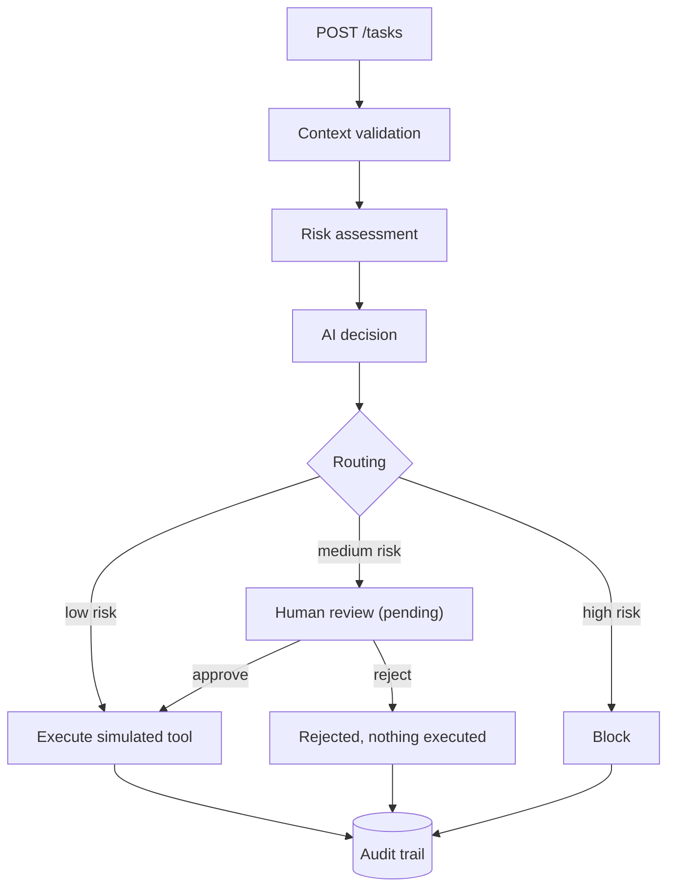

# Agentic Human Review Workflow

A small agentic AI demo system that shows how to let an AI agent act **safely**: every task is risk-assessed and routed to automatic execution, human review, or a hard block. Tool actions are simulated, and every step is written to an audit trail.

> This repository is a portfolio implementation. Certain production components, policy logic, integrations and proprietary orchestration mechanisms are intentionally excluded. Production repositories are maintained privately.

## What it demonstrates

- **Agentic AI orchestration**: intake, validation, risk assessment, decision, routing, execution
- **Human in the loop**: medium-risk tasks wait for an explicit approve or reject
- **Risk-based routing**: low risk runs automatically, medium needs review, high is blocked
- **Tool execution control**: actions only run after routing allows them (simulated, no real APIs)
- **Auditability**: every important step is recorded with actor, decision and details
- **Failure handling**: retry with backoff, exception queue, no silent failures
- **Backend engineering**: Python 3.11+, FastAPI, Pydantic, service layer, pytest

## Flow



Fail-safe rule: the risk engine can tighten the AI decision but never loosen it. If the AI says "allow" for a high-risk task, it is still blocked.

## Quick start

Requires Python 3.11 or newer.

```bash
python -m venv .venv
# Windows PowerShell: .\.venv\Scripts\Activate.ps1
# macOS / Linux:      source .venv/bin/activate
pip install -r requirements.txt
uvicorn app.main:app --reload
```

Open `http://127.0.0.1:8000/docs` for the interactive API (use `--port 8010` if port 8000 is taken).

Run the tests:

```bash
pytest
```

## API

| Method | Path | Purpose |
|---|---|---|
| GET | `/` | Service info |
| GET | `/health` | Health check |
| POST | `/tasks` | Submit a task. The outcome is in the `status` field: `executed`, `pending_review`, `blocked` or `failed` |
| GET | `/reviews` | List review items (optional `?status=pending`) |
| POST | `/reviews/{id}/approve` | Approve a pending review and execute the action (simulated) |
| POST | `/reviews/{id}/reject` | Reject a pending review, nothing is executed |
| GET | `/audit` | Audit trail (optional `?task_id=...`) |
| GET | `/exceptions` | Failures recorded in the exception queue |

Errors: `422` invalid input, `404` unknown review, `409` review already decided, `500` internal workflow error (details are only in the audit trail and exception queue).

## Example

Submit a medium-risk task (external recipient):

```bash
curl -X POST http://127.0.0.1:8000/tasks \
  -H "Content-Type: application/json" \
  -d '{
    "user_input": "Send the quarterly update to the client",
    "requested_action": "send_email",
    "target_system": "mail",
    "context": { "external_recipient": true }
  }'
```

The response has `"status": "pending_review"` and a `review_id`. Nothing has been executed yet. Approve it:

```bash
curl -X POST http://127.0.0.1:8000/reviews/<review_id>/approve \
  -H "Content-Type: application/json" \
  -d '{ "reviewer": "alice", "note": "checked" }'
```

Then `GET /audit` shows the full chain: `task_received`, `risk_assessed`, `decision_created`, `review_required`, `review_approved`, `action_executed`.

To demo failure handling, add `"simulate_transient_failures": 2` (succeeds on the third attempt) or `"simulate_permanent_failure": true` (ends in the exception queue) to the task context.

## Project structure

```
app/
  main.py                FastAPI app: thin HTTP layer
  schemas.py             Pydantic models
  services/
    risk.py              Demo risk engine (additive scoring)
    decision.py          Rule-based mock decision provider
    routing.py           Risk-based routing (fail-safe)
    execution.py         Simulated tools, retry, backoff
    audit.py             Append-only audit trail
    exceptions.py        Error types and exception queue
    workflow.py          Orchestration of the whole flow
  human_review/
    queue.py             Review queue
    decisions.py         Approve / reject
tests/                   pytest suite (124 tests)
docs/architecture.md     Architecture and design decisions
```

See [docs/architecture.md](docs/architecture.md) for details.

## Scope and limitations

This is a demo, not a production system:

- Risk rules and weights are generic and illustrative.
- The "AI decision" is a deterministic rule-based mock behind a provider interface. No LLM, no prompts, no API keys.
- All tool actions are simulated. No external system is ever called.
- Storage is in memory and is lost on restart.
- There is no authentication or authorization.

## License

MIT. See [LICENSE](LICENSE).