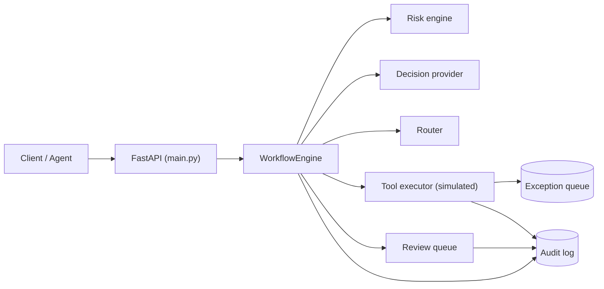
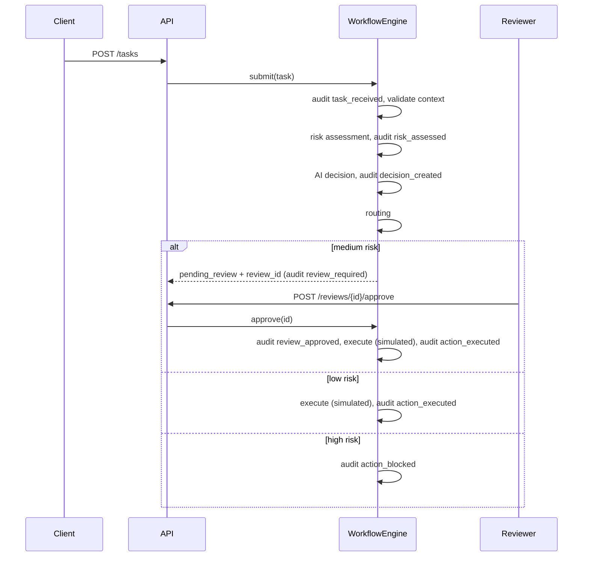

# Architecture

> This repository is a portfolio implementation. Certain production components, policy logic, integrations and proprietary orchestration mechanisms are intentionally excluded. Production repositories are maintained privately.

## Overview

The system is a control layer between "an agent wants to do something" and "it happens". Each task passes through risk assessment, an AI decision and routing. Only then is a (simulated) tool action executed, held for a human, or blocked. Everything is audited.

`main.py` only translates HTTP into engine calls and domain errors into status codes. All logic lives in the service layer. The engine receives its dependencies (audit log, queues, decision provider) from outside, so tests run against isolated instances.

## Request lifecycle

## Components

| Module | Responsibility |
|---|---|
| `schemas.py` | Pydantic models: task, decision, risk, review item, execution result, audit event, exception record |
| `risk.py` | Pure function `assess_risk(task)`. Additive score, capped at 100, with reasons |
| `decision.py` | `DecisionProvider` protocol and a rule-based implementation. A real LLM provider could be injected without touching the rest |
| `routing.py` | Combines decision and risk into one of three routes |
| `execution.py` | Simulated tool handlers, retry with exponential backoff, exception handling |
| `audit.py` | Append-only, thread-safe audit log that returns copies only |
| `exceptions.py` | Transient and permanent error types, exception queue |
| `queue.py` | Thread-safe review queue with atomic resolve |
| `decisions.py` | Approve / reject, writes the audit event |
| `workflow.py` | Orchestrates all of the above |

## Risk assessment (demo values)

| Signal | Points |
|---|---|
| Base risk: `read_record` 5, `create_ticket` 15, `update_crm` 20, `send_email` 25, `delete_record` 25 | 5 to 25 |
| Sensitive data | +30 |
| Destructive action | +35 |
| External recipient | +25 |
| Privileged operation | +30 |
| Impact: medium / high | +10 / +20 |
| Unclear context (very short request) | +15 |

The score is capped at 100. Below 30 is low, 30 to 59 is medium, 60 and above is high. These weights are illustrative and are not production policy.

## Decision and routing

The mock decision provider maps risk to `allow`, `review` or `deny` with a confidence score. Low risk with confidence below 0.75 (for example an unclear request) goes to review instead of auto-allow.

| Risk level | AI decision | Route |
|---|---|---|
| low | allow | auto execute |
| low | review | human review |
| medium | any except deny | human review |
| high | any | block |
| any | deny | block |

Fail-safe: the risk engine can only tighten the outcome. This is covered by tests for an AI that returns "allow" on high-risk and medium-risk tasks.

## Audit trail

Every event has `timestamp`, `task_id`, `event`, `decision`, `actor` and `details`.

| Event | Written when |
|---|---|
| `task_received` | A task enters the system |
| `risk_assessed` | The risk engine has scored the task |
| `decision_created` | The AI decision exists |
| `review_required` | The task was queued for human review |
| `review_approved` / `review_rejected` | A reviewer decided |
| `action_executed` | The simulated action ran successfully |
| `action_blocked` | The action was deliberately not executed (high risk or rejected) |
| `retry_attempted` | A transient failure is being retried |
| `exception` | A failure that is not recovered (validation, execution, pipeline) |

The log is append-only. Reads return copies, so a caller cannot alter stored events.

## Failure handling

- **Transient errors** are retried up to 3 attempts with exponential backoff (0.2 s, then 0.4 s). Each retry is audited.
- **Permanent and unexpected errors** are not retried, because an unknown failure may not be safe to repeat.
- **No silent failures.** Every final failure is written to the exception queue and the audit trail. The task response reports `failed` with the exception id.
- **Pipeline crashes** (for example the decision provider failing) raise an internal error, return HTTP 500 without internal details, and are recorded in the exception queue.
- **Double decisions** on a review are rejected with HTTP 409, even under concurrent requests.

## Design decisions

- **Dependency injection** for the engine, audit log, queues and decision provider keeps tests isolated and makes components replaceable.
- **Pure risk function**: no side effects, easy to test, deterministic.
- **Provider interface** for decisions: the demo uses rules, a production system could plug in an LLM without changing routing or execution.
- **Explicit `is None` checks** for injected dependencies. The audit log and queues define `__len__`, so an empty instance is falsy and `x or default` would silently swap it. A bug of exactly this kind was caught by the test suite during development.

## Limitations

In-memory storage, no authentication, no real tool integrations, and a mock decision provider. A production setup would add persistent storage, authentication and authorization, a real policy layer, and real integrations. These parts are intentionally not part of this repository.